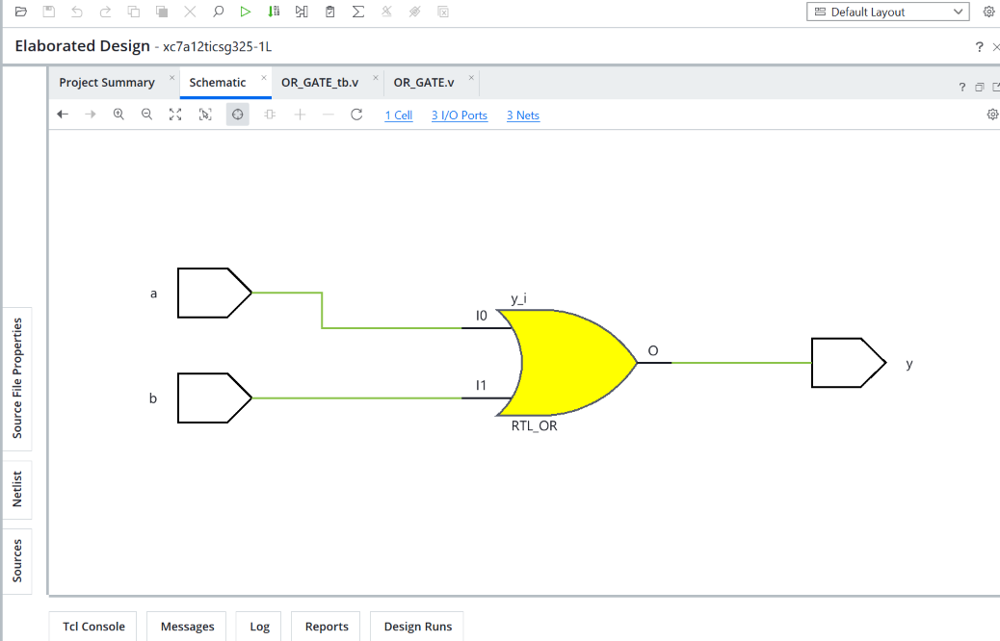
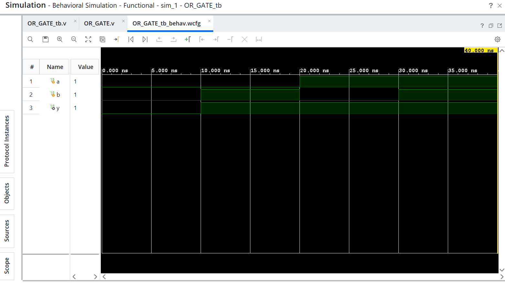
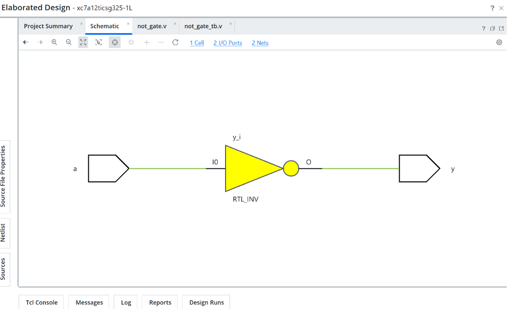
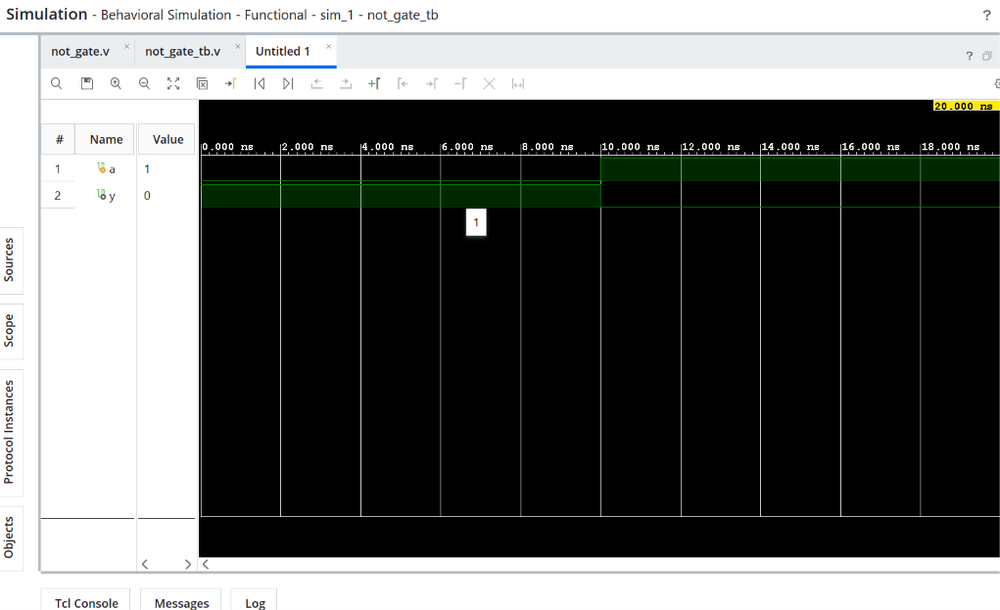

# Logic Gates Design and Simulation using Verilog HDL

## 📌 About the Project

This repository contains the design and simulation of basic digital logic gates using **Verilog Hardware Description Language (HDL)**.

The objective of this project is to understand the working principles of basic logic gates through Verilog coding, testbench development, circuit schematics, and simulation waveforms using Xilinx Vivado.

## 🛠️ Tools and Technologies

- **HDL:** Verilog
- **Software:** Xilinx Vivado
- **Simulation:** Behavioral Simulation
- **Design Type:** Digital Logic Design

## 📂 Repository Structure

```text
Logic-Gates/
│
├── AND-Gate/
│   ├── and_gate.v
│   ├── and_gate_tb.v
│   ├── and_gate_schematic.png
│   └── and_gate_waveform.png
│
├── OR-Gate/
│   ├── or_gate.v
│   ├── or_gate_tb.v
│   ├── or_gate_schematic.png
│   └── or_gate_waveform.png
│
├── NOT-Gate/
│   ├── not_gate.v
│   ├── not_gate_tb.v
│   ├── not_gate_schematic.png
│   └── not_gate_waveform.png
│
└── README.md
```

## 1. AND Gate

An AND gate produces HIGH output (1) only when both inputs are HIGH (1).

**Boolean Expression:** `Y = A & B`

### Truth Table

| A | B | Y |
|---|---|---|
| 0 | 0 | 0 |
| 0 | 1 | 0 |
| 1 | 0 | 0 |
| 1 | 1 | 1 |

### Design Files
- [Verilog Code](AND-Gate/and_gate.v)
- [Testbench](AND-Gate/and_gate_tb.v)

### Circuit Schematic


### Simulation Waveform


## 2. OR Gate

An OR gate produces HIGH output (1) when at least one of its inputs is HIGH (1).

**Boolean Expression:** `Y = A | B`

### Truth Table

| A | B | Y |
|---|---|---|
| 0 | 0 | 0 |
| 0 | 1 | 1 |
| 1 | 0 | 1 |
| 1 | 1 | 1 |

### Design Files
- [Verilog Code](OR-Gate/or_gate.v)
- [Testbench](OR-Gate/or_gate_tb.v)

### Circuit Schematic


### Simulation Waveform


## 3. NOT Gate

A NOT gate is also known as an inverter. It produces the complement of its input.

**Boolean Expression:** `Y = ~A`

### Truth Table

| A | Y |
|---|---|
| 0 | 1 |
| 1 | 0 |

### Design Files
- [Verilog Code](NOT-Gate/not_gate.v)
- [Testbench](NOT-Gate/not_gate_tb.v)

### Circuit Schematic


### Simulation Waveform


## 🎯 Learning Outcomes

Through this project, I learned:

- Basic digital logic gate operations.
- Verilog HDL coding.
- Testbench development and verification.
- Behavioral simulation using Xilinx Vivado.
- Understanding circuit schematics and simulation waveforms.


**Author:** Ajay Kumar

**GitHub:** [Ajaykumar752](https://github.com/Ajaykumar752)

**Project:** Logic Gates Design and Simulation using Verilog HDL

